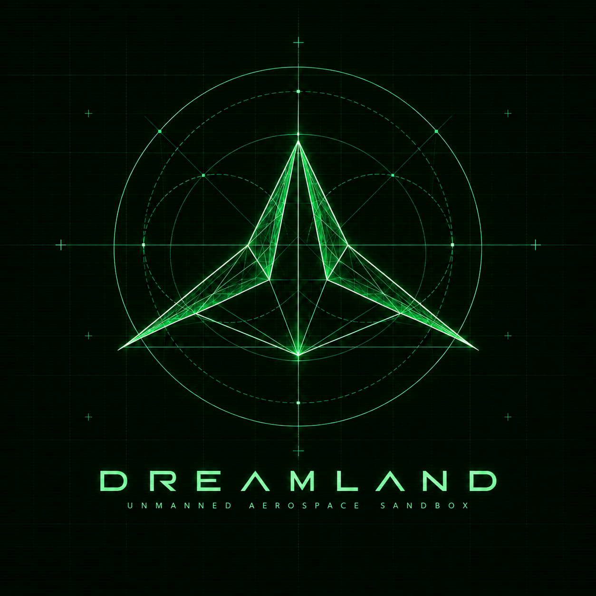
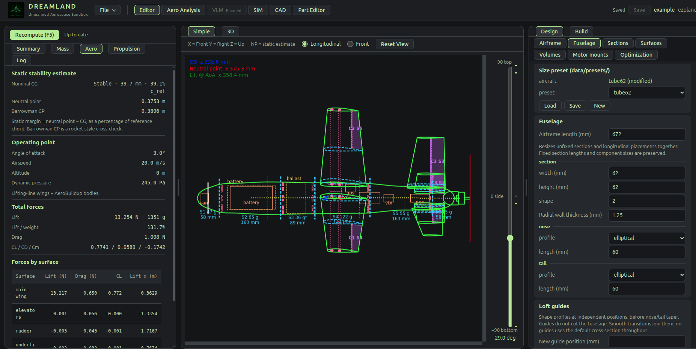
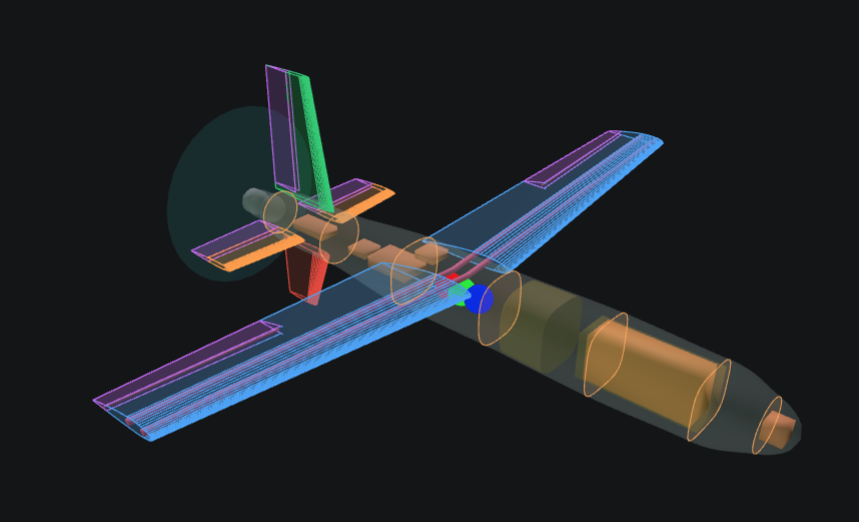
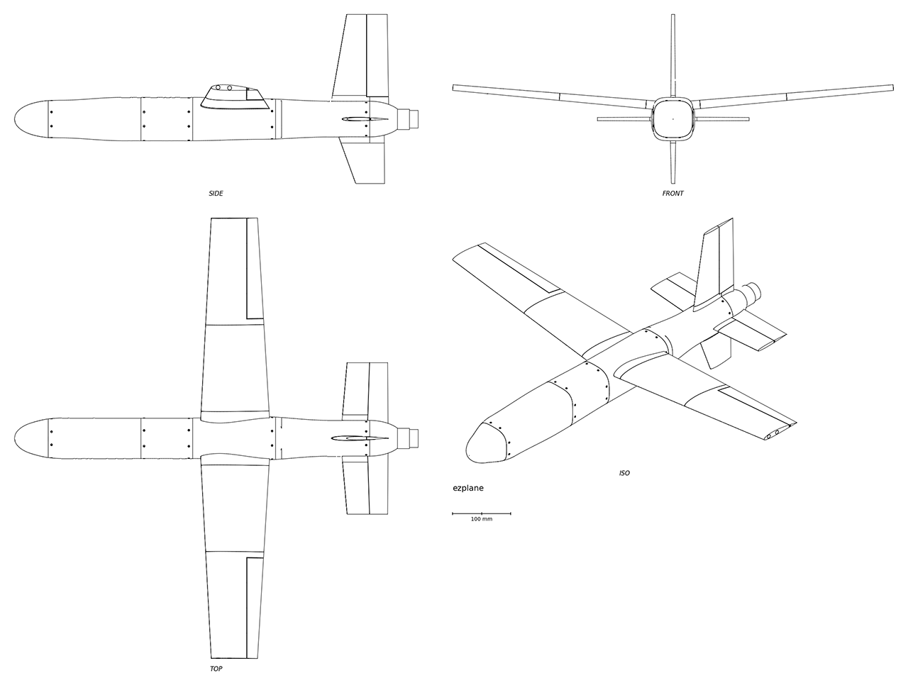
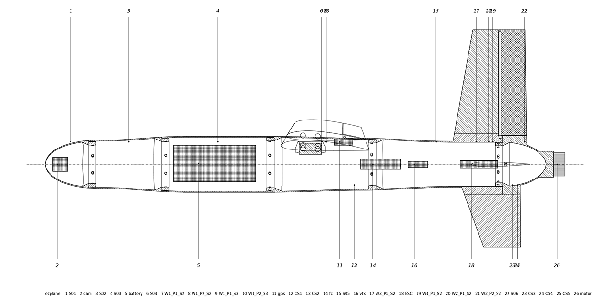

<p align="center">
  
</p>

<h1 align="center">Dreamland</h1>

<p align="center"><b>Unmanned Aerospace Sandbox</b><br>Design it. Fly it on real firmware. Print it.</p>

<p align="center">
  <a href="LICENSE"></a>
  
  
  
</p>

<p align="center">
  <code>uav</code> · <code>drone</code> · <code>vtol</code> · <code>tailsitter</code> · <code>model-rocketry</code> · <code>aircraft-design</code> · <code>lofting</code> · <code>aerodynamics</code> · <code>aerosandbox</code> · <code>jsbsim</code> · <code>inav</code> · <code>sitl</code> · <code>cadquery</code> · <code>3d-printing</code>
</p>

---

Dreamland is a sandbox design and simulation environment for small unmanned aircraft and rockets. You loft an airframe, attach lifting surfaces, mount propulsion and place real components inside it; Dreamland computes how it balances, how it flies and what it weighs, flies it in simulation against real flight-controller firmware, and generates the printable parts.

It is built for hobby flying: RC planes, drones, gliders, rockets, anything you can imagine.

<p align="center">
  
</p>

**One aircraft file in. A stability report, a flight simulation on the actual autopilot, blueprints and STEP files for the printer out.** Drag a wing along the fuselage and the CG, neutral point, static margin, forces and drawing follow within a couple of seconds.

## Why it is different

- **PhD not required.** The sandbox allows you to sketch and test your dream quickly, without needing a degree in aerospace engineering or mastering half a dozen professional grade engineering and simulation tools. The analysis, simulation and helpers take the guesswork out and allow you to iterate quickly. Results answer the questions builders ask: does it balance, is it stable, can it hover, how long does it fly, will the parts fit, and what do I print.
- **The real autopilot flies your design before you build it.** Dreamland exports a JSBSim model of your aircraft and the INAV firmware itself flies it in SITL, from the same kind of diff you would load onto the flight controller. The mixer profiles and servo mix come from the geometry, with servo directions worked out from each surface's computed moments.
- **Physics from parts, not guesses.** Motor and prop performance comes from published calculator data, and wiring losses from the actual wire runs, gauges and connectors in your layout. Printed mass is computed from the geometry and your print settings. Weigh a real part and its measured mass replaces the estimate.
- **Rockets are first-class.** Dreamland draws inspiration directly from Rocksim and OpenRocket and simulates solid rocket motors, with liquid-fuel motors on the roadmap. Load a real motor from a RASP thrust-curve database, set it on a launch rail and light it from a script. The propellant burns off along the curve, so mass and CG move in flight, and you get rail exit, burnout, top speed and apogee.
- **Write your own flight controller.** Besides INAV, a Python script can be the flight controller. It reads simulated raw sensors (IMU, baro, mag, GPS, pitot, rangefinder) in real hardware units and writes PWM, the way an MCU, Arduino or ESP32 would.
- **From design to printer.** Each printable section comes out with its couplers, screw holes, rod and spar channels, hollowed to the wall thickness. Blueprints (cutaway, three-view, x-ray) are generated from the same solids. Automated CAD export tools are used to their full capability, without you needing a 5-digit subscription to a professional CAD suite. 

<table>
  <tr>
    <td width="50%"></td>
    <td width="50%"></td>
  </tr>
  <tr>
    <td align="center"><i>The live 3D view: see-through skin, every part in place, CG / NP / lift markers</i></td>
    <td align="center"><i>Generated three-view with an iso view and scale bar</i></td>
  </tr>
</table>

<p align="center">
  
  <br><i>Generated cutaway: every printable section and coupler cut on the centreline, hatched and numbered</i>
</p>

## Vision

Kerbal Space Program for real hardware. A vehicle is whatever its parts make it: a lofted body with wings and electric motors is a plane, add hover motors and it is a VTOL, swap in a solid motor and it is a rocket. Dreamland derives capability from the design instead of starting from a fixed aircraft type.

One definition is the single source of truth. The same file drives the drawing, the aerodynamics, the simulation model, the flight-controller configuration and the CAD. Nothing is entered twice, and nothing downstream becomes a second copy of the aircraft.

## Features

### Airframe design
- **Lofted fuselage**: superellipse cross-sections (circle to rounded box) at independent loft stations, joined with cubic easing and tapered by parametric nose and tail profiles
- **Lifting surfaces**: wing and fin sets in H, X, +, 1 and 3 layouts, body- or axis-rooted, with sweep, dihedral, incidence or cant, airfoils, spars and carry-through webs
- **Control surfaces**: split or all-moving, with hinge geometry, gaps, pivot rods, deflection limits and servo assignment
- **Internal layout**: volumes for battery, ballast and avionics; library parts placed and checked for fit and overlap; wire runs routed between battery, ESC and motors
- **Structure**: longitudinal reinforcement rods, wire channels, cut stations with couplers or integral spigots and radial screw joints
- **Part library**: flight controllers, ESCs, receivers, VTX, GPS, cameras, servos, batteries, props, connectors and materials, with a built-in part editor

### Propulsion
- **Electric**: motors, props, commercial or custom Li-ion packs, ESCs and wiring
- **Rocket**: solid motors from a RASP thrust-curve database, loaded into tail or surface mounts, with their thrust curve plotted
- Tractor or pusher, nose, tail or wing-mounted motors, pods, spin direction and thrust-line tilt

### Analysis
- Mass, CG, CG range and inertia; printed-part mass estimated from geometry and print settings, replaceable by weighed values
- Lifting-line aerodynamics for every surface plus body buildup, with NeuralFoil section polars at the real Reynolds number
- Neutral point, static margin, trim and stall across an angle-of-attack sweep, with a Barrowman cross-check
- Thrust, current, hover point, thrust-to-weight and flight time; liftoff and burnout figures for rockets
- 2D airfoil comparison
- Vortex-lattice (VLM) sweep, headless for now

### Simulation
- JSBSim model exported from the design: mass properties, aero tables, motor and prop tables, rocket burns, control surfaces
- **INAV SITL** on a generated, editable INAV diff
- **Custom flight controllers** in Python: raw sensors in, PWM out
- Scenarios: hover, efficiency and range, top speed, glide, control response, stability, rocket launch; each can set its own default start (air, ground, catapult or launch rail); live plots and a 3D replay of the flight in the browser, rocket flames included

### Manufacturing
- STEP and STL of the whole airframe, of each printable section and coupler, and of wing segments
- Blueprint drawings: side cutaway, three-view with iso view, and x-ray
- FreeCAD varsets for downstream detailing

### Interfaces
- Browser UI: Editor (2D drawing and 3D view), Aero Analysis, SIM, CAD and Part Editor
- Everything also runs headless from the command line

## What's coming

Dreamland is growing fast. On the roadmap:

- **Optimizer**: name a goal (range, speed, endurance) and ranges for the part values; Dreamland searches wing span, chords, sweep, wing position, battery placement, motor and prop within printer, stability and stall constraints, then flies the best candidates in SITL.
- **Performance flash card**: efficiency, stall speed, sustained turn rate, per-axis acceleration, range and maximum altitude for every design at a glance.
- **Rockets, all the way up**: recovery (ejection at the motor's delay, parachutes), staging (ignite a stage on the previous one's burnout), rocket ignition from INAV, transonic and supersonic aero, and later liquid-fuel motors, up to space.
- **CFD**: GPU lattice-Boltzmann (FluidX3D) and overnight OpenFOAM sweeps as an independent check on the lifting-line model.
- **VLM view**: the vortex-lattice solution and streamlines rendered in the browser.
- **More autopilots**: PX4 and ArduPilot on JSBSim and Gazebo; MSP and MAVLink commands from scenarios.
- **More propulsion**: internal combustion and hobby jet turbines.
- **Copters**: classic FPV plate and tube frames.
- **Printable details**: hatches, wire routing with auto-generated conduits, automatic sectioning, fin root blending.

The full list is in [TODO.md](TODO.md).

## Getting started

Python 3 with `aerosandbox`, `neuralfoil`, `cadquery`, `jsbsim`, `aiohttp`, `numpy`, `scipy`, `pandas`, `matplotlib` and `threadpoolctl`; Node.js for the browser UI. Simulation also needs `inav-jsbsim-bench`, and INAV runs need an INAV SITL build.

```bash
cd web && npm install && npm run build
```

```bash
python webbuilder.py aircraft/example
```

The full command reference is in [docs/usage.md](docs/usage.md).

## Documentation

| Document | Contents |
|---|---|
| [docs/usage.md](docs/usage.md) | Commands, project layout, flight scenarios |
| [docs/analysis.md](docs/analysis.md) | Reading results, calculation stages, accuracy limits |
| [docs/ui/](docs/ui/) | Browser UI, one file per view |
| [PLAN.md](PLAN.md) | Design decisions and the aircraft definition schema |
| [TODO.md](TODO.md) | Open work |

## Status

Under active development. Results are for comparing designs and catching bad ones before printing, not for certifying an aircraft; [docs/analysis.md](docs/analysis.md) lists what the models leave out.

## License

Dreamland is free software, released under the [GNU General Public License v3.0](LICENSE).
